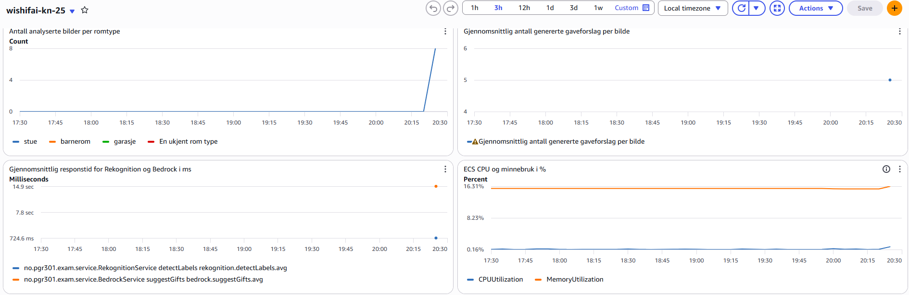
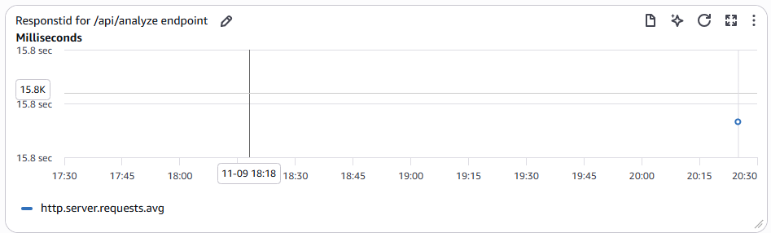

# Besvarelse PGR301 Eksamen 2026

## 1A
Dockerfile bruker multistage build. Build-stage bygger JAR-filen med Maven, og runtime-stage inneholder bare Java-runtime og den ferdige JAR-filen. Maven og kildekoden blir dermed ikke med i det ferdige imaget.

### Build and run (fra repo-root)
```bash
docker build -t wishifai .
```
```bash
docker run --rm -p 9999:8080 \
  -e AWS_ACCESS_KEY_ID="$(aws configure get aws_access_key_id)" \
  -e AWS_SECRET_ACCESS_KEY="$(aws configure get aws_secret_access_key)" \
  -e AWS_REGION=eu-west-1 \
  -e S3_BUCKET=wishifai-images-25 \
  wishifai
```

### Test
```bash
curl -F "image=@samples/sample_image.png" http://localhost:9999/api/analyze
```

## 1B
Workflowen kjører kun ved push til main. Den bygger containerimaget og pusher det til ECR og Docker Hub. AWS-nøkler og innloggingsinformasjon til Docker Hub hentes fra GitHub Secrets.

### Begrunnelse for tagging-strategi
Jeg bruker short-sha slik at imaget kan knyttes til commiten det ble bygget fra. Det er enklere enn å lese en full-sha, og sannsynligheten for at to tagger blir like er liten i et prosjekt på denne størrelsen.

Imaget får også taggen "latest", som gjør det enkelt å hente det siste publiserte imaget fra Docker Hub. Når man deployer brukes sha-taggen for å kunne spore hvilken versjon som kjører.

### Lenke til grønn kjøring
https://github.com/FredrickBWolff/Eksamen-DevOps-kn-25/actions/runs/42255182164


## 2A

### Offentlig URL
https://wi-1adedda40af042cda796c157e898d1eb.ecs.eu-west-1.on.aws

## 2B
Terraform-state lagres i S3-bucketen: pgr301-terraform-state

```
whisifai/25/terraform.tfstate
```

Det er en liten skrivefeil i "whisifai", men jeg valgte å beholde den fordi det funker.

## 2C

### Hvorfor er det fornuftig at Terraform kjører etter container-build?
Terraform kjører etter containeren er bygget fordi imaget må finnes i ECR før ECS kan hente det. Kjører de parallelt eller i motsatt rekkefølge, kan Terraform prøve å deploye et image som ikke er publisert enda. Feiler buildet, blir heller ikke noe deployet.

### Lenke til grønn kjøring
https://github.com/FredrickBWolff/Eksamen-DevOps-kn-25/actions/runs/42397201715

## 3A
Metrikkene ligger i CloudWatch under namespace wishifai-kn-25.
Jeg bruker @Timed på "rekognition.detectLabels" og "bedrock.suggestGifts". @Timed måler hvor lang tid metodene bruker, inkludert AWS-kallene. Hvis tjenesten blir treg, kan man undersøke hvilket steg som bruker mer tid enn vanlig.

Som business-metrikk bruker jeg Counter for "images.analyzed" for å telle hvor mange bilder som analyseres per roomType. Dette gir innsikt i hvor mye tjenesten brukes og hvilke rom som analyseres oftest.

Jeg bruker også Counter for "gift.suggestions.generated" for å telle antall gaveforslag. Ved å dele antallet gaveforslag på antallet analyserte bilder i samme periode får man gjennomsnittlig antall forslag per bilde. Hvis snittet faller burde man undersøke hvorfor det er tilfellet.

## 3B
### Business-metrikker
- Viser antall analyserte bilder per roomType og gjennomsnittlig antall gaveforslag per bilde. De gir en oversikt over bruken og forslagene tjenesten gir.

### Infrastruktur-metrikker
- Viser CPU og minnebruk i ECS, slik at man kan følge med på ressursbruken.

### Applikasjon-metrikker
- Viser HTTP-responstiden fra Spring Boot Actuator for vellykkede requests til "/api/analyze". Sammen med tidsbruken for Rekognition og Bedrock gjør dette det lettere å undersøke hva som forårsaker forsinkelser hvis det oppstår.

### Alarm
Alarmen jeg satte opp, "wishifai-kn-25-suggestions-per-image", går av når gjennomsnittlig antall gaveforslag per bilde faller til under tre over tre perioder etter hverandre på 5 minutter. Jeg valgte å sette threshold til 3 for å oppdage om tjenesten begynner å gi færre forslag over tid. Normalt gir tjenesten 5 forslag per bilde, og prompten ber om inntil 5 forslag. Hvis den gir færre trenger ikke det bety at noe er galt, men det vil være lurt å undersøke om det er en grunn til det.
Perioder hvor det ikke er noe trafikk behandles som notBreaching, slik at alarmen ikke går bare fordi det ikke er noen som bruker tjenesten.

### Bilde av CloudWatch dashboard (wishifai-kn-25)



## 4
Når man bruker generativ AI i en applikasjon, må man ta hensyn til at svarene kan variere og inneholde feil. Selv om koden fungerer og tjenesten svarer uten tekniske feil, kan innholdet være misvisende eller skadelig. Samme modell kan gi forskjellige svar på samme spørsmål, og et modellbytte kan påvirke svarene på grunn av forskjeller i trening, hvordan den følger instrukser og hvordan den svarer. DevOps må derfor håndtere kvaliteten på outputen til AI i tillegg til funksjonaliteten.

Når man tester en applikasjon som bruker AI, må man også sjekke om svarene er riktige og relevante. Ved å bruke et eval-sett som inneholder test cases og kriterier for hva som er gode svar, kan man kjøre de samme test casene på gammel og ny versjon og vurdere svarene etter de samme kriteriene. Den gamle outputen kan brukes til sammenligning, men den kan også inneholde feil. LLM-as-judge kan gjøre vurderingen raskere, men denne modellen kan også vurdere feil. Derfor bør man ta stikkprøver hvor man sjekker noen av svarene manuelt. Hvor grundig man tester, og når testene kjøres i pipelinen, burde tilpasses risikoen. Enkle automatiske tester kan kjøres hver gang man gjør endringer for å få rask tilbakemelding. Før release kan man også kjøre større evalueringer og gjennomføre stikkprøver. Ved høy risiko burde man også kontrollere svarene fra kritiske test cases manuelt.

Ved kontinuerlig leveranse må man holde oversikt over hvilken kode, modell og hvilke instrukser som brukes sammen. Dette gjør det lettere å finne årsaken hvis kvaliteten faller. Med feature flags kan man styre om applikasjonen bruker et nytt eller gammelt oppsett. Da kan man bytte tilbake uten å deploye på nytt. For å innføre endringer gradvis kan man bruke canary release, hvor en liten del av trafikken går til det nye oppsettet først. Dette gjør at man kan undersøke kvaliteten på svarene før flere får tilgang til det nye oppsettet. Canary begrenser hvor mange som kan få feil svar, men ved høy risiko burde mer av kontrollen skje før release.

Etter release må overvåkingen følge med på både teknisk drift, som responstid og token-forbruk, og innholdet i svarene fra AI. Alarmen jeg satte opp for Wishifai, er konfigurert til å gå av når gjennomsnittlig antall gaveforslag per analyserte bilde faller under tre. Den sjekker derimot ikke om forslagene er upassende, så stikkprøver og tilbakemeldinger fra brukere ville gitt bedre innsikt i kvaliteten på forslagene. Feil man finner i produksjon, burde brukes som nye test cases slik at de kan oppdages ved senere endringer.

Hvor omfattende kontrollene bør være, avhenger av konsekvensene av feil. Et gaveforslag som er lite relevant for en bruker kan håndteres etter en release. Derimot hvis feil kan føre til økonomiske tap, burde man stille strengere krav til testing før release og kontrollere rådene før kunden bruker dem. Ved høyere risiko bør derfor større endringer gjennomgås med et menneske i loopen. Dette tar lengre tid, men når feilen kan ha alvorlige konsekvenser for en bruker, burde kontrollen prioriteres selv om releasen blir forsinket.
